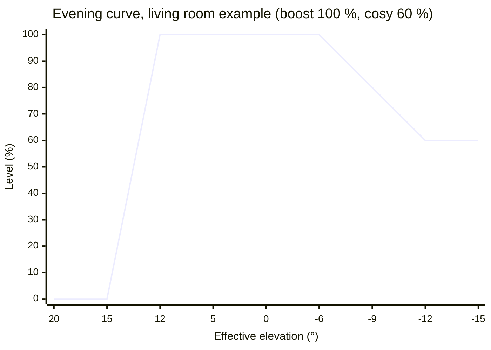
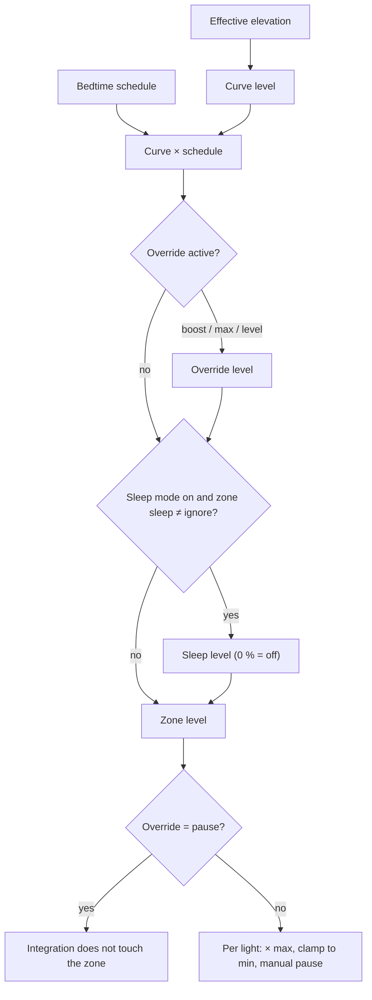

# Night Compensation — design

Status: **draft for review** (2026-11-03). No code yet.

A Home Assistant custom integration that drives lights per **zone** from how dark it is outside, with a
bedtime schedule, a sleep mode, an eye-adjustment boost at dusk, and overrides for visitors.
It replaces a set of template sensors, helpers and a script that runs every minute.

## 1. Goals and non-goals

Goals:

- Several zones (for example *Outside*, *Hallway*, *Living room mood*), each fully configurable.
- One darkness axis per zone, the **effective elevation**, fed by the sun position or a lux sensor.
- Lights come on earlier in winter and later in summer.
- Eye adjustment: more light at dusk while eyes are still used to daylight, then a slow settle to a cosy level.
- Respect people: a manual change to a light pauses that light; an override handles visitors; sleep mode wins over everything.
- Every user-facing level is in **percent (0–100 %)**. Angles are in degrees, durations in minutes or seconds.

Non-goals:

- Colour temperature or colour (use Adaptive Lighting for that).
- Presence or motion detection. A zone can be paused or overridden by other automations through the actions in §8.
- Owning the sleep-mode entity. The integration reads an existing `input_boolean` (or any on/off entity); switching it on and resetting it stays with the user's own automations.

## 2. Concepts

| Term | Meaning |
|---|---|
| Zone | A group of lights with one set of settings. One config subentry, one HA device. A light belongs to at most one zone. |
| Effective elevation (E) | The darkness axis, in degrees. Equals the real solar elevation, shifted by season, or derived from a lux sensor (§3). |
| Curve level | 0–100 %, computed from E by the zone's evening or morning curve (§4). |
| Schedule level | 0–100 %, from the bedtime schedule (§5). |
| Zone level | The final level after schedule, sleep, overrides (§6). Exposed as `sensor.<zone>_level`. |
| Light brightness | Zone level × the light's maximum, clamped to the light's minimum (§7). |
| Phase | Where the zone is in its day: `day`, `evening_ramp`, `peak`, `settle`, `cosy`, `bedtime_fade`, `night`, `morning_ramp`, `sleep`. Phase changes end manual pauses. |

## 3. Effective elevation

### 3.1 Source: sun model (default)

The integration computes the real solar elevation `e` itself every minute (astral, HA's location).
The season term `s` runs from −1 at the June solstice to +1 at the December solstice, following the solar declination δ:

```
s = −δ / 23.44°
E = e − winter_bias × s
```

With `winter_bias = 3°`, the effective sun is 3° lower in December (lights on earlier) and 3° higher in June (lights on later).
At the equinoxes E = e.

### 3.2 Source: lux sensor (optional)

A lux sensor facing the sky (outside, or behind a window that none of the zone's lights can reach).
The measured lux is smoothed (rolling mean, default 10 min) and converted to the elevation at which a clear sky gives that much light,
by log-linear interpolation in this table:

| Elevation | Clear-sky horizontal illuminance (approx.) |
|---|---|
| −18° | 0.0007 lx |
| −12° | 0.008 lx |
| −6° | 3.4 lx |
| 0° | 600 lx |
| 5° | 5 500 lx |
| 10° | 16 000 lx |
| 20° | 38 000 lx |
| 30° | 55 000 lx |
| 60° | 100 000 lx |

The table is approximate and gets calibrated against the real sensor once one is installed.
On an overcast afternoon of 2 000 lx, E ≈ 2.7° while the real sun may be at 15°: the lights react to the actual darkness.
`winter_bias` still applies (usually set to 0 with a sensor).

Fallbacks:

- Below the sensor's floor (many cheap sensors report 0 below ~1 lx), or when the sensor is unavailable for more than 10 min, E falls back to the sun model.
- When E from the sensor is higher than the sun model allows (sensor in direct sun), the sun model is used.

### 3.3 Reachability caps

The curve thresholds must be reachable every day:

- At 52°N the sun reaches only 14.7° on 21 December, so an evening threshold of 15° is never crossed and the lights would never switch off.
- In June the sun only gets down to about −14.5°, so a settle threshold below that is never reached.

Each day the integration computes the day's highest and lowest E from the sun model. A threshold above `highest − 1°` or below `lowest + 1°` is shifted to that cap.
When a pair of thresholds (for example a ramp's start and full) would collapse, the whole ramp is shifted with its width kept.
The zone shows a repair notice in HA while caps are active, so the user knows why their settings behave differently that day.

## 4. Curves

Which curve applies depends on whether the sun is setting (after solar noon: evening curve) or rising (before solar noon: morning curve).
Both curves give 0 % in full daylight, so the switch at noon is continuous.
Interpolation between thresholds is linear in E.

### 4.1 Evening curve, with boost

| Phase | E range | Curve level |
|---|---|---|
| `day` | E ≥ `evening_start` | 0 % |
| `evening_ramp` | `evening_start` > E ≥ `evening_full` | 0 → `peak` |
| `peak` | `evening_full` > E ≥ `hold_until` | `peak` |
| `settle` | `hold_until` > E ≥ `settle_end` | `peak` → `cosy` |
| `cosy` | E < `settle_end` | `cosy` |

With boost off, `peak = cosy` and the `peak` and `settle` phases disappear: the ramp goes straight to the cosy level.



### 4.2 Morning curve

No boost (eyes are adapted to the dark). From `cosy` to 0 % between `morning_start` and `morning_off`:

| Phase | E range | Curve level |
|---|---|---|
| `cosy` | E < `morning_start` | `cosy` |
| `morning_ramp` | `morning_start` ≤ E < `morning_off` | `cosy` → 0 % |
| `day` | E ≥ `morning_off` | 0 % |

### 4.3 Example timelines (52°N, sun model, winter bias 0°)

Living room example: evening 15° → 12°, hold until −6°, settle to cosy by −12°.

| Date | Ramp 15°→12° | Sunset | Hold ends (−6°) | Cosy (−12°) |
|---|---|---|---|---|
| 21 June | 19:58 → 20:19 | 22:01 | 22:47 | 00:05 |
| 3 November | 14:52 → 15:21 | 17:05 | 17:38 | 18:18 |
| 21 December | capped to 13.7° → 10.7°: 13:27 → 14:25 | 16:27 | 17:06 | 17:49 |

## 5. Bedtime schedule (optional per zone)

Four times: `off_weekday`, `on_weekday`, `off_weekend`, `on_weekend`, and `fade` (minutes).
Schedule level is 100 %, fades to 0 % over `fade` minutes from the off time, stays 0 % until the on time, and fades back up over `fade` minutes.

- **A night belongs to the evening it started.** The nights of Friday and Saturday use the weekend times, all others the weekday times. The part before noon belongs to the previous date.
- **Times on both sides of midnight work.** An off time of 23:00 and an on time of 07:00 is a window of 8 hours. The current implementation compares seconds since midnight and breaks for off times before midnight.
- With sleep mode available, the indoor schedule mostly acts as a fallback for when sleep mode is forgotten.

## 6. Composing the zone level



Order, highest priority first:

1. **Pause** override: the zone's lights are left alone entirely.
2. **Sleep mode** (if the zone's sleep behaviour is not `ignore`): the zone goes to its sleep level (`off` or a set %), with its own fade time. Switching sleep mode on clears the zone's `boost`, `max` and `level` overrides.
3. **Override** `boost` (curve as if E were in the peak phase: stays at `peak`, no settle), `max` (100 %) or `level` (a set %).
4. **Curve level × schedule level.**

## 7. Driving the lights

- Per light: `max` (% of the light's full brightness) and `min` (% below which the light flickers or stays dark).
  Brightness = zone level × `max`. If that is above 0 but below `min`, it becomes `min`. At 0 % the light is switched off.
- A command is only sent when the brightness changes by at least 1 %, or when on/off changes. Normal steps use a 2 s transition; sleep uses the zone's sleep fade.
- **Rate limit**: the zone level moves at most `max_step` % per minute (default 5 %), so a passing cloud on the lux sensor never makes lights jump.
  Sleep, override and manual changes bypass the rate limit.
- **Manual change detection**: a light state change whose context did not come from the integration (a wall switch, the app, a voice command)
  pauses that light until the zone's next phase change. Becoming unavailable and available again does not count as a manual change.
- Recalculation: every 60 s, and immediately on a change of sleep mode, override, zone settings or the lux sensor.

## 8. Actions and events

| Action | Fields | Effect |
|---|---|---|
| `night_compensation.set_override` | `zone` (one or more zone devices), `mode` (`boost` / `max` / `level` / `pause`), `level` (%), `until` (`next_phase` / `sleep` / `morning` / `duration`), `duration` | Sets an override. |
| `night_compensation.clear_override` | `zone` | Back to automatic, also clears manual pauses. |

Event `night_compensation_phase_changed` with `zone`, `from`, `to`, so other automations can react, for example "close the curtains when the living room enters `peak`".

## 9. Configuration

### 9.1 Zone configuration (config subentry, set once)

| Setting | Values |
|---|---|
| Name | text |
| Lights | list, each with `max` and `min` % |
| Source | `sun` or `lux` + lux sensor entity + smoothing minutes |
| Sleep entity | default `input_boolean.nightmode` |
| Sleep behaviour | `off` / `ignore` / `level` |
| Use bedtime schedule | yes/no |
| Use boost | yes/no |

### 9.2 Zone entities (adjustable at any time, dashboard-friendly)

| Entity | Unit | Example (living room) |
|---|---|---|
| `sensor.<zone>_level` | % | attributes: phase, curve level, schedule level, effective elevation, source, caps active |
| `sensor.<zone>_phase` | enum | `cosy` |
| `sensor.<zone>_effective_elevation` (diagnostic) | ° | −13.2 |
| `number.<zone>_evening_start` / `_evening_full` | ° | 15 / 12 |
| `number.<zone>_peak` | % | 100 |
| `number.<zone>_hold_until` / `_settle_end` | ° | −6 / −12 |
| `number.<zone>_cosy` | % | 60 |
| `number.<zone>_morning_start` / `_morning_off` | ° | 12 / 15 |
| `number.<zone>_winter_bias` | ° | 3 |
| `number.<zone>_max_step` | %/min | 5 |
| `time.<zone>_off_weekday` / `_on_weekday` / `_off_weekend` / `_on_weekend` | time | 00:00 / 07:00 / 02:00 / 10:00 |
| `number.<zone>_bedtime_fade` | min | 30 |
| `number.<zone>_sleep_level` / `_sleep_fade` | % / s | 0 / 10 |
| `select.<zone>_mode` | enum | `auto` / `boost` / `max` / `level` / `pause` |
| `number.<zone>_override_level` | % | 80 |

Entities for options a zone does not use (boost, schedule, sleep level) are not created.

## 10. Implementation outline

- Domain `night_compensation`, `integration_type: service`, `iot_class: calculated`. No external requirements beyond astral, which HA ships.
- One config entry, one subentry per zone, one device per zone.
- `curve.py`: pure functions (effective elevation, caps, curves, schedule, composition). No HA imports, so it is unit-tested directly over a full simulated year.
- `zone.py`: one controller per zone: timer, listeners (sleep entity, lux sensor, its lights), rate limit, manual-change detection, sending commands.
- Platforms: `sensor`, `number`, `time`, `select`. Settings are stored with `RestoreEntity`.
- Tests: `curve.py` against the example timelines in §4.3 and the caps in §3.3; controller tests with fake lights for manual changes, sleep, overrides and the rate limit.

## 11. Migration from the current setup (later, not now)

The migration ports today's behaviour 1:1 first (boost off), so nobody at home notices the switch. Boost and winter bias are enabled afterwards.
It is done while someone who knows about it is at home.

| Zone | Lights (max %) | Curve now | Schedule | Sleep |
|---|---|---|---|---|
| Outside | `terrasdeur_light`, `voordeur_light` (6); `shellydimmer2_48e7297d2798` (oprit, 100); `shellyprodm1pm_fce8c0d81a74` (tuin achter, 15); `kantoor_buiten_achter`, `kantoor_buiten_voor` (8); `shellyprodm1pm_a0dd6c9e2390_light_0` (tuin voor, 15) | 0° → −10°, morning −10° → 0° | yes | ignore |
| Hallway | `gang_achter`, `gang_trap`, `gang_voordeur`, `gang_woonkamer` (4) | 15° → 12°, morning 12° → 15° | yes | off, 10 s |
| Living room mood | `woonkamer_sfeer_no`, `_nw`, `_zo`, `_zw`, `_tv` (100) | 15° → 12°, morning 12° → 15° | no | off, 10 s |
| Living room spots | `woonkamer_boekenkast` (90), `woonkamer_spots_wand` (100) | 15° → 12°, morning 12° → 15° | no | off, 10 s |

Removed afterwards:

- Template sensors: `indoor_nightcompensation_sun`, `outdoor_nightcompensation_sun`, `nightcompensation_time`, `indoor_nightcompensation`, `outdoor_nightcompensation`.
- Script `nachtverlichting` and automation `Nachtverlichting`, plus the `script.nachtverlichting` calls in the two sleep-mode button automations.
- Helpers: the four `*_solar_elevation_on/off`, `night_time_dim_minutes`, the four `lights_on/off_*`, the nine brightness helpers, and `gang_verlichting_handmatig`. The latter is replaced by `select.hallway_mode` = `level` (it sets brightness 100 of 255 ≈ 39 %).

Known issues in the current setup that this design fixes:

- An off time before midnight turns the lights back on after the fade.
- `woonkamer_boekenkast` is set twice per minute, by the mood block and by its own block.
- Commands are sent every minute, which undoes manual dimming and adds Wi-Fi traffic to Shellys.
- An indoor off threshold of 15° is never reached around December; the lights stay dimmed on all day.
- Equal on and off elevations divide by zero.

## 12. Open questions

- Q-001: Calibrate the lux table (§3.2) once a sensor is installed. Which sensor, and where?
- Q-002: Should `boost` also exist as a morning option for people who wake before dawn, or is "no boost in the morning" always right?
- Q-003: Default `max_step` of 5 %/min: is that slow enough to be invisible and fast enough for the evening ramp (the fastest ramp in §4.3, 21 June, goes 0 → 100 % in 21 min, about 4.8 %/min)?
