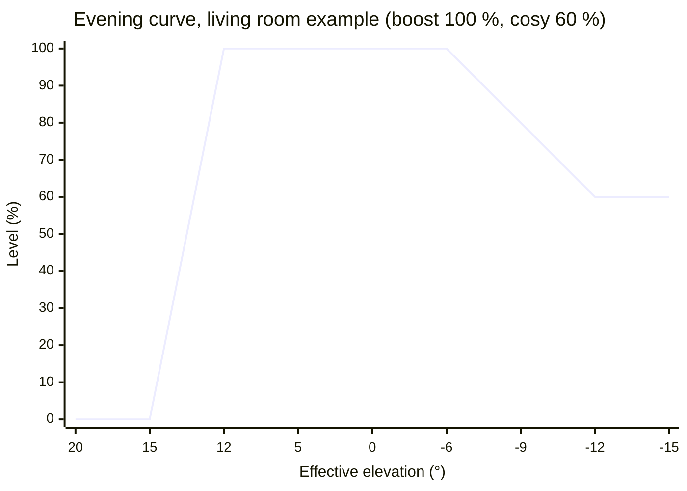
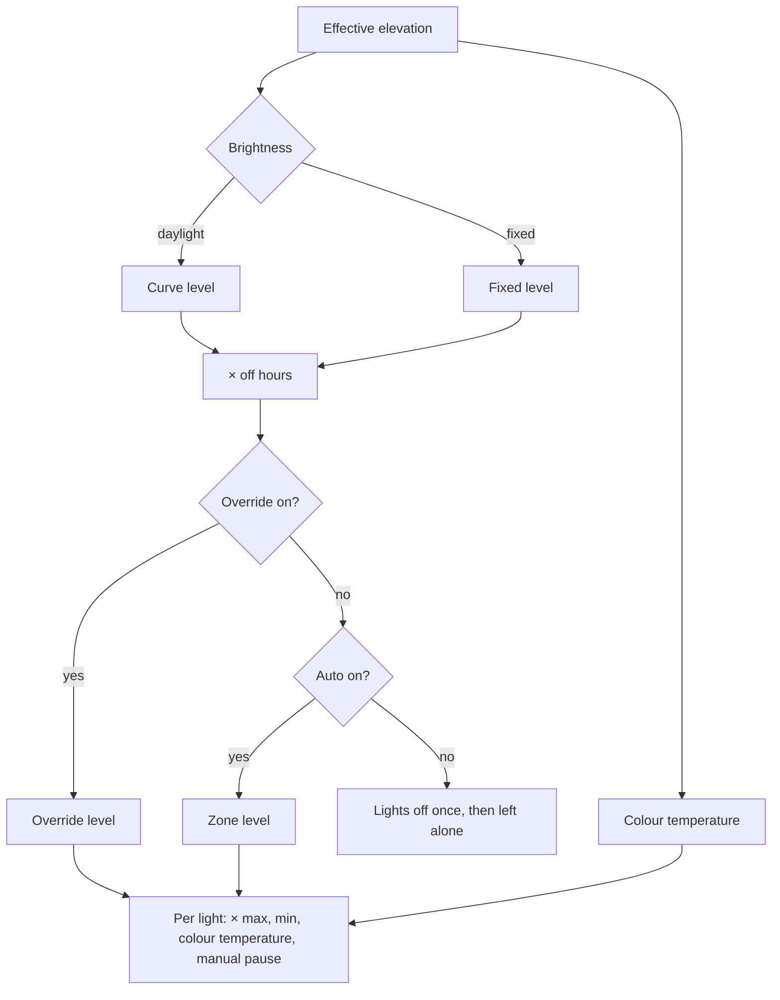

# Daylight Zones — design

Status: **implemented, not released** (2026-11-04). Version 0.1.0 is in this repository and tested, but not installed on any Home Assistant yet.

A Home Assistant custom integration that manages lights per **zone**: brightness and colour temperature that follow
the daylight outside, off hours, an auto switch and an override switch per zone. It replaces template sensors,
helpers and a script that runs every minute.

## 1. Goals and non-goals

Goals:

- Zones that may be a room, part of a room, or span several rooms. Each zone is configured on its own.
- One darkness axis per zone, the **effective elevation**, fed by the sun position or a lux sensor.
- Brightness that follows daylight (on earlier in winter, a boost at dusk while eyes are still used to daylight, a slow
  settle to a cosy level), or a fixed level.
- Colour temperature that follows daylight: cool by day, warmer at dusk, warmest at night.
- Off hours: fade out at night and come back in the morning, or switch the zone off.
- Two switches per zone: **auto** (follow the sun and manage the lights) and **override** (lights at a set level).
- Respect people: a manual change to a light pauses that light.
- Every user-facing level is in percent (0–100 %). Angles are in degrees, colour temperatures in kelvin, durations in minutes or seconds.

Non-goals:

- Sleep mode, presence and motion. Sleep mode is one automation (blueprint in §9.3); presence and motion can drive a
  zone through the actions in §9.1.
- Colour (RGB). Only colour temperature.

## 2. Concepts

| Term | Meaning |
|---|---|
| Zone | A group of lights with one set of settings. One config subentry, one HA device. A light belongs to at most one zone. |
| Effective elevation (E) | The darkness axis, in degrees: the real solar elevation shifted by season, or derived from a lux sensor (§3). |
| Auto | Switch. On: the zone follows the sun and manages its lights. Off: lights off, and the zone leaves them alone. |
| Override | Switch. On: the zone's lights at the override level, also when auto is off. Ends when switched off, at the latest the next solar noon. |
| Brightness | `daylight` (curve over E, §4.1) or `fixed` (one level, §4.2). |
| Off hours | `none`, `window` (fade out at the off time, back at the on time) or `switch_off` (fade out at the off time, then auto off) (§6). |
| Zone level | The final level, 0–100 %. Exposed as `sensor.<zone>_level`. |
| Light brightness | Zone level × the light's maximum, raised to the light's minimum (§8). |
| Phase | Where the zone is: `day`, `evening_ramp`, `peak`, `settle`, `cosy`, `morning_ramp` (daylight brightness), `on` (fixed brightness), `off_fade`, `off_hours`, `on_fade` (off hours), `override`, `auto_off`. A change of phase ends manual pauses. |

## 3. Effective elevation

### 3.1 Source: sun model (default)

The integration computes the real solar elevation `e` itself every minute (astral, HA's location).
The season term `s` runs from −1 at the June solstice to +1 at the December solstice, following the solar declination δ:

```
s = −δ / 23.44°
E = e − winter_bias × s
```

With `winter_bias = 3°` the effective sun is 3° lower in December (lights on earlier, colour warmer) and 3° higher in June.

### 3.2 Source: lux sensor (optional)

A lux sensor facing the sky (outside, or behind a window that none of the zone's lights can reach).
The measured lux is smoothed (mean of log10 over a window, default 10 min) and converted to the elevation at which a
clear sky gives that much light, by log-linear interpolation in this table:

| Elevation | Clear-sky horizontal illuminance (approx.) |
|---|---|
| −18° | 0.0007 lx |
| −12° | 0.008 lx |
| −6° | 3.4 lx |
| 0° | 600 lx |
| 5° | 5 500 lx |
| 10° | 16 000 lx |
| 20° | 38 000 lx |
| 30° | 55 000 lx |
| 60° | 100 000 lx |

The table is approximate and gets calibrated once a sensor is installed. On an overcast afternoon of 2 000 lx, E ≈ 2.7°
while the real sun may be at 15°: lights and colour react to the actual darkness. `winter_bias` still applies (usually 0 with a sensor).

Fallbacks: below 1 lx, or with no reading for 10 min, the sun model is used. E is never higher than the sun model (a sensor in direct sun).

### 3.3 Reachability caps

At 52°N the sun reaches only 14.7° on 21 December, and only gets down to about −14.5° in June. Each day the integration
computes the day's highest and lowest E; brightness thresholds above `highest − 1°` or below `lowest + 1°` are shifted
to that cap, keeping a ramp's width. `sensor.<zone>_level` shows `caps_active` while this happens.

## 4. Brightness

### 4.1 Daylight

Which curve applies depends on whether the sun is setting (after solar noon: evening) or rising (before solar noon: morning).
Both give 0 % in full daylight, so the switch at noon is continuous. Interpolation is linear in E.

Evening:

| Phase | E range | Level |
|---|---|---|
| `day` | E ≥ `evening_start` | 0 % |
| `evening_ramp` | `evening_start` > E ≥ `evening_full` | 0 → `peak` |
| `peak` | `evening_full` > E ≥ `hold_until` | `peak` |
| `settle` | `hold_until` > E ≥ `settle_end` | `peak` → `cosy` |
| `cosy` | E < `settle_end` | `cosy` |

Without boost, `peak = cosy` and the `peak` and `settle` phases disappear.



Morning: no boost (eyes are adapted to the dark). `cosy` below `morning_start`, `cosy` → 0 % up to `morning_off`, then `day`.

Example timeline at 52°N, sun model, winter bias 0°, living room: evening 15° → 12°, hold until −6°, cosy by −12°.

| Date | Ramp 15°→12° | Sunset | Hold ends (−6°) | Cosy (−12°) |
|---|---|---|---|---|
| 21 June | 19:58 → 20:19 | 22:01 | 22:47 | 00:05 |
| 3 November | 14:52 → 15:21 | 17:05 | 17:38 | 18:18 |
| 21 December | capped to 13.7° → 10.7°: 13:27 → 14:25 | 16:27 | 17:06 | 17:49 |

### 4.2 Fixed

One level (`number.<zone>_level`) whenever auto is on; elevation has no effect on brightness. Phase `on`.
For zones like an office, where brightness should not change through the day but colour temperature should.

## 5. Colour temperature (optional)

Follows E with three points: `ct_night` at `ct_night_elevation` and below, `ct_dusk` at 0°, `ct_day` at `ct_day_elevation` and above, linear in between.

| E | Example |
|---|---|
| ≥ 20° | 5000 K |
| 10° | 4250 K |
| 0° | 3500 K |
| −4° | 2950 K |
| ≤ −8° | 2400 K |

- With daylight brightness, the boost at dusk is automatically cooler and the settle warmer: one story for brightness and colour.
- With a lux sensor, a grey day gives a warmer colour.
- Only lights whose `supported_color_modes` include `color_temp` get a colour temperature, clamped to their own
  `min_color_temp_kelvin`/`max_color_temp_kelvin`. Other lights in the zone get brightness only.
- Colour temperature moves at most 100 K per minute; a command is sent when it differs 50 K or more from the last one sent.
- During an override the colour temperature keeps following daylight; only the brightness is overridden.

## 6. Off hours (optional per zone)

Times: an off time per weekday and weekend, and for `window` also an on time; and `off_fade` (minutes).
A night belongs to the evening it started: the nights of Friday and Saturday use the weekend times. Times on both sides of midnight work.

| Mode | At the off time | Afterwards |
|---|---|---|
| `window` | fade to 0 over `off_fade` | 0 until the on time, then fade back up over `off_fade`; the brightness curve keeps applying (level = curve × off hours) |
| `switch_off` | fade to 0 over `off_fade` | auto switches off. The zone stays off until it is switched on again; the next switch-off is the first off moment after that, so working late does not switch it off again the same night |

Outdoor example (`window`, curve 0° → −10°, off 02:00, on 07:00, fade 30 min), at 52°N:

| Date | Evening on | Night | Morning |
|---|---|---|---|
| 4 November | 17:03 → full at 18:09 | 02:00 → off 02:30 | 07:00 fading on while daylight is already coming: about 40 % around 07:25, off at 07:42 |
| 21 December | 16:27 → full at 17:41 | 02:00 → off 02:30 | 07:00 → full at 07:30, fades out with daylight from 07:35 to 08:48 |
| 20 March | 18:50 → full at 19:53 | 02:00 → off 02:30 | stays off: sun up at 06:45 |
| 21 June | 22:00 → full at 23:40 | 02:00 → off 02:30 | stays off: sun up at 05:22 |

## 7. Composing the zone level



1. **Override** on: the override level, whatever auto is.
2. **Auto** off: when auto switches off the lights go off (10 s fade, or the action's `transition`); after that the zone does not touch them.
3. Otherwise: brightness (daylight curve or fixed level) × off hours.

## 8. Driving the lights

- Per light: `max` (% of the light's full brightness) and `min` (% below which it flickers or stays dark).
  Brightness = zone level × `max`; if above 0 but below `min`, it becomes `min`; at 0 % the light is switched off.
- A command is only sent when on/off, the light's 0–255 brightness value, or its colour temperature (§5) changes. Measuring in brightness values
  keeps dim lights smooth: a light with a 4 % maximum has only about 10 values. Normal steps use a 2 s transition.
- **Rate limit**: the zone level moves at most `max_step` % per minute (default 5 %), so a passing cloud never makes lights jump.
  Switching auto or override bypasses the limit.
- **Manual change detection**: a change of a light's state, brightness or colour temperature whose context did not come from the integration
  pauses that light until the zone's next phase, or until auto or override switches. Not counted as manual: becoming unavailable and available again,
  a report within the transition time + 5 s after the integration's own command, or one that matches the command (3 %, 150 K).
- Recalculation every 60 s, and immediately on a change of a switch, a setting, or the lux sensor.

## 9. Actions, events and blueprints

### 9.1 Actions

All take `zone`: one or more zone devices.

| Action | Fields | Effect |
|---|---|---|
| `daylight_zones.auto_on` | | Auto on. |
| `daylight_zones.auto_off` | `until` (`noon`), `transition` (s) | Auto off, lights off. With `until: noon`, auto switches back on at the next solar noon. |
| `daylight_zones.auto_toggle` | | Toggle auto. |
| `daylight_zones.override_on` | `level` (%), `until` (`next_phase` / `noon` / `duration`, default `noon`), `duration` | Override on. |
| `daylight_zones.override_off` | | Override off. |
| `daylight_zones.override_toggle` | | Toggle override (until the next solar noon). |

### 9.2 Event

`daylight_zones_phase_changed` with `zone`, `zone_id`, `from`, `to`, for example "close the curtains when the living room enters `peak`".

### 9.3 Blueprints (in `blueprints/automation/daylight_zones/`)

- **Trigger to zone action**: any trigger (a button press type, a detached Shelly input, a door contact, an event) runs one of the actions in §9.1 on the chosen zones.
- **Sleep mode**: when a sleep-mode entity switches on, turn the chosen zones off with a fade, until the next solar noon.

## 10. Configuration

### 10.1 Zone configuration (config subentry)

| Setting | Values |
|---|---|
| Name | text |
| Lights | list, each with `max` and `min` % (shown with the lights' friendly names) |
| Darkness source | `sun`, or `lux` + lux sensor + smoothing minutes |
| Brightness | `daylight` / `fixed` |
| Dusk boost | yes/no (daylight only) |
| Colour temperature follows daylight | yes/no |
| Off hours | `none` / `window` / `switch_off` |

### 10.2 Zone entities

Entities for settings a zone does not use are not created.

| Entity | Unit | Used when | Example |
|---|---|---|---|
| `switch.<zone>_auto` | | always | on; attribute `until` |
| `switch.<zone>_override` | | always | off; attribute `until` |
| `sensor.<zone>_level` | % | always | attributes: phase, curve level, off-hours level, effective elevation, source, caps, auto, override, paused lights |
| `sensor.<zone>_phase` | enum | always | `cosy` |
| `sensor.<zone>_effective_elevation` (diagnostic) | ° | always | −13.2 |
| `sensor.<zone>_colour_temperature` | K | colour temperature | 2400 |
| `number.<zone>_evening_ramp_start` / `_evening_ramp_full` | ° | daylight | 15 / 12 |
| `number.<zone>_boost_peak` / `_boost_hold_until` / `_settle_to_cosy_by` | % / ° / ° | daylight + boost | 100 / −6 / −12 |
| `number.<zone>_cosy_level` | % | daylight | 60 |
| `number.<zone>_morning_ramp_start` / `_morning_off` | ° | daylight | 12 / 15 |
| `number.<zone>_level` | % | fixed | 80 |
| `number.<zone>_winter_bias` | ° | daylight or colour temperature | 3 |
| `number.<zone>_maximum_step` | %/min | always | 5 |
| `number.<zone>_colour_temperature_day` / `_dusk` / `_night` | K | colour temperature | 5000 / 3500 / 2400 |
| `number.<zone>_day_colour_from` / `_night_colour_from` | ° | colour temperature | 20 / −8 |
| `time.<zone>_off_weekday` / `_off_weekend` | time | off hours | 00:00 / 02:00 |
| `time.<zone>_on_weekday` / `_on_weekend` | time | off hours `window` | 07:00 / 10:00 |
| `number.<zone>_off_hours_fade` | min | off hours | 30 |
| `number.<zone>_override_level` | % | always | 80 |

Settings and the auto switch (with its `until`) survive restarts. The override does not.

## 11. Implementation outline

- Domain `daylight_zones`, `integration_type: service`, `iot_class: calculated`, single config entry, one subentry and one device per zone.
  No requirements beyond astral, which HA ships.
- `curve.py`: pure functions (effective elevation, caps, curves, colour temperature, off hours, composition), no HA imports.
- `zone.py`: one controller per zone: timer, listeners, switches, rate limits, manual-change detection, sending commands.
- Platforms: `sensor`, `number`, `time`, `switch`.
- Tests:
  - `curve.py` against the timelines in §4.1 and §6, the caps in §3.3, colour temperature, and off hours including working late;
  - a comparison with the replaced template formulas over a full year (sun factor) and a week (off hours);
  - controller tests with fake lights: auto and override, fixed brightness, colour temperature and clamping, manual pauses (brightness and colour), switch-off, rate limit, restarts;
  - an end-to-end run of 26 hours minute by minute against the replaced script: at most 1 brightness value apart, 20 commands instead of 1 560;
  - both blueprints loaded through HA's blueprint and automation validation.

## 12. Example zones and migration (later, not now)

The migration ports today's behaviour 1:1 first (boost off, cosy 100 %, maximum step 100 %/min, winter bias 0°, no colour temperature),
so nobody at home notices the switch. New features are enabled afterwards. It is done while someone who knows about it is at home.

| Zone | Lights (max %) | Brightness | Off hours | Colour temperature |
|---|---|---|---|---|
| Outside | `terrasdeur_light`, `voordeur_light` (6); `shellydimmer2_48e7297d2798` (oprit, 100); `shellyprodm1pm_fce8c0d81a74` (tuin achter, 15); `kantoor_buiten_achter`, `kantoor_buiten_voor` (8); `shellyprodm1pm_a0dd6c9e2390_light_0` (tuin voor, 15) | daylight 0° → −10°, morning −10° → 0° | window 00:00–07:00 / 02:00–10:00 | no |
| Hallway | `gang_achter`, `gang_trap`, `gang_voordeur`, `gang_woonkamer` (4) | daylight 15° → 12°, morning 12° → 15° | window | later |
| Living room mood | `woonkamer_sfeer_no`, `_nw`, `_zo`, `_zw`, `_tv` (100) | daylight 15° → 12°, morning 12° → 15° | none | later |
| Living room spots | `woonkamer_boekenkast` (90), `woonkamer_spots_wand` (100) | daylight 15° → 12°, morning 12° → 15° | none | later |
| Office (new) | office lights | fixed 80 % | switch_off 22:00 | yes |

- Sleep mode: the sleep-mode blueprint with `input_boolean.nightmode` turns Hallway and both Living room zones off until noon (today: off with a 10 s fade).
- The office is switched by a trigger-to-zone-action automation (detached Shelly input or door contact → toggle the office zone).
- Removed afterwards:
  - template sensors `indoor_nightcompensation_sun`, `outdoor_nightcompensation_sun`, `nightcompensation_time`, `indoor_nightcompensation`, `outdoor_nightcompensation`;
  - script `nachtverlichting`, automation `Nachtverlichting`, and the `script.nachtverlichting` calls in the two sleep-mode button automations;
  - helpers: the four `*_solar_elevation_on/off`, `night_time_dim_minutes`, the four `lights_on/off_*`, the nine brightness helpers, and
    `gang_verlichting_handmatig` (replaced by `switch.hallway_override` with override level 39 %, as it sets brightness 100 of 255).

Known issues in the current setup that this fixes:

- An off time before midnight turns the lights back on after the fade.
- `woonkamer_boekenkast` is set twice per minute, by the mood block and by its own block.
- Commands are sent every minute, which undoes manual dimming and adds Wi-Fi traffic to Shellys.
- An indoor off threshold of 15° is never reached around December; the lights stay dimmed on all day.
- Equal on and off elevations divide by zero.

## 13. Open questions

- Q-001: Calibrate the lux table (§3.2) once a sensor is installed. Which sensor, and where?
- Q-002: Should a zone skip switching on in the morning when the level would stay below a set %? (the short 07:00–07:42 burst in §6, November)
- Q-003: Default `max_step` of 5 %/min: slow enough to be invisible, fast enough for the evening ramp (21 June goes 0 → 100 % in 21 min, about 4.8 %/min)?
